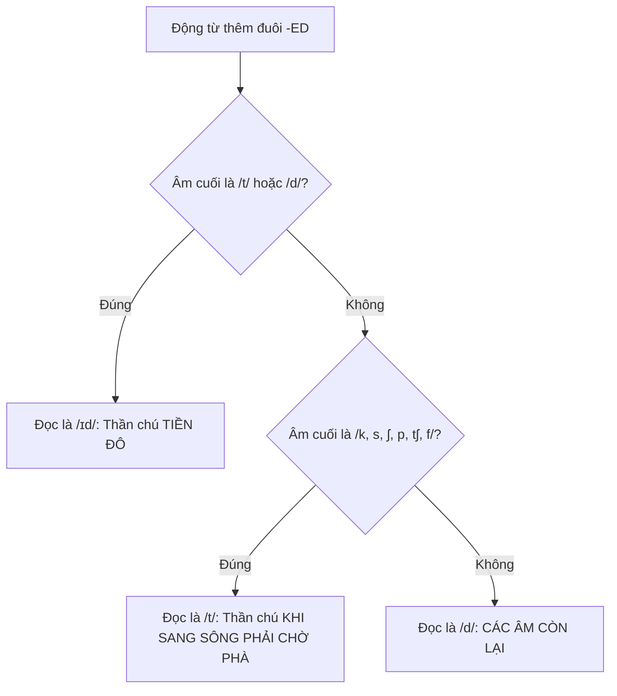

# CHUYÊN ĐỀ 1: CÁCH PHÁT ÂM ĐUÔI "ED" BẰNG CÂU THẦN CHÚ & NGOẠI LỆ TÍNH TỪ

> [!BLUE] **BẢN CHẤT CỐT LÕI (FEYNMAN CORE):**
> Trong tiếng Anh, đuôi **`-ed`** chỉ là hình thái chữ viết cho thì Quá khứ và Phân từ 2. Âm thanh thực tế phát ra phụ thuộc vào **Âm cuối cùng (Ending Sound)** của động từ trước khi thêm -ed:
> - **Âm rung (Hữu thanh):** Cổ họng rung ➔ Đuôi -ed phát âm là **/d/** (cùng tính chất rung).
> - **Âm không rung (Vô thanh):** Cổ họng không rung ➔ Đuôi -ed phát âm là **/t/** (cùng tính chất vô thanh).
> - **Âm /t/ hoặc /d/:** Để tránh dính 2 âm giống nhau liền kề ➔ Chèn thêm nguyên âm /ɪ/ thành **/ɪd/**.

---

## I. SƠ ĐỒ CÂU THẦN CHÚ PHÁT ÂM ĐUÔI -ED TRONG 3 GIÂY

---

## II. 3 QUY TẮC PHÁT ÂM "ED" KÈM BỘ THẦN CHÚ TIẾNG VIỆT BẤT HỦ

### 1. Quy tắc 1: Phát âm là `/ɪd/` (Thần chú: "TIỀN ĐÔ" hoặc "TÌNH ĐẦU")
- **Dấu hiệu:** Động từ có âm kết thúc là **/t/** hoặc **/d/**.
- **Thần chú ghi nhớ:**
  > 💡 **"TIỀN ĐÔ"** (hoặc **"TÌNH ĐẦU"**): **T**iền (`/t/`) - **Đ**ô (`/d/`).
- **Ví dụ chuẩn:**
  - *wanted* /ˈwɒn.tɪd/ *(muốn)*
  - *needed* /ˈniː.dɪd/ *(cần)*
  - *decided* /dɪˈsaɪ.dɪd/ *(quyết định)*
  - *visited* /ˈvɪz.ɪ.tɪd/ *(thăm quan)*
  - *waited* /ˈweɪ.tɪd/ *(chờ đợi)*

---

### 2. Quy tắc 2: Phát âm là `/t/` (Thần chú: "KHI SANG SÔNG PHẢI CHỜ PHÀ")
- **Dấu hiệu:** Động từ có âm kết thúc là các âm vô thanh **/k, s, ʃ, p, tʃ, f/** (Chữ cái thường gặp: *k, c, p, s, ss, x, sh, ch, gh, ph, ce*).
- **Thần chú ghi nhớ độc quyền:**
  > 💡 **"KHI SANG SÔNG PHẢI CHỜ PHÀ"**
  > (hoặc: **"Chính Phủ Phát Sách Không Thèm Share"**)
  >
  > - **K**hi (`/k/` - k, c, p): *cook ➔ cooked* `/kʊkt/`, *look ➔ looked* `/lʊkt/`, *ask ➔ asked* `/æskt/`
  > - **S**ang (`/s/` - s, x, ce): *dance ➔ danced* `/dɑːnst/`, *fix ➔ fixed* `/fɪkst/`, *kiss ➔ kissed* `/kɪst/`
  > - **S**ông (`/ʃ/` - sh): *wash ➔ washed* `/wɒʃt/`, *wish ➔ wished* `/wɪʃt/`, *push ➔ pushed* `/pʊʃt/`
  > - **P**hải (`/p/` - p): *stop ➔ stopped* `/stɒpt/`, *hope ➔ hoped* `/həʊpt/`, *help ➔ helped* `/helpt/`
  > - **C**hờ (`/tʃ/` - ch): *watch ➔ watched* `/wɒtʃt/`, *catch ➔ catched* `/kætʃt/`
  > - **P**hà (`/f/` - gh, ph): *laugh ➔ laughed* `/lɑːft/`, *cough ➔ coughed* `/kɒft/`

---

### 3. Quy tắc 3: Phát âm là `/d/` (Các trường hợp còn lại)
- **Dấu hiệu:** Động từ có âm kết thúc là các âm hữu thanh còn lại (`/b, ɡ, v, z, m, n, ŋ, l, r/`) và các nguyên âm.
- **Ví dụ chuẩn:**
  - *played* `/pleɪd/`, *cleaned* `/kliːnd/`, *opened* /ˈəʊ.pənd/, *loved* `/lʌvd/`, *cried* `/kraɪd/`.

---

## III. BẢNG 10 TÍNH TỪ NGOẠI LỆ "VÀNG" (LUÔN PHÁT ÂM LÀ /ɪd/)

> [!RED] **BẪY GÀI 100% CỦA ĐỀ THI TUYỂN SINH VÀO 10:**
> Các từ dưới đây khi đóng vai trò là **Tính từ (Adjective)** thì đuôi **-ed LUÔN ĐỌC LÀ `/ɪd/`**, bất kể âm phía trước là gì!

| Tính từ ngoại lệ | Phiên âm IPA | Dịch nghĩa tiếng Việt | Cụm từ hay gặp trong đề thi |
| :--- | :--- | :--- | :--- |
| **naked** | /ˈneɪ.kɪd/ | Khỏa thân, trần trụi | *a naked eye* (mắt trần) |
| **wicked** | /ˈwɪk.ɪd/ | Độc ác, tàn nhẫn | *a wicked witch* (mụ phù thủy độc ác) |
| **sacred** | /ˈseɪ.krɪd/ | Thiêng liêng, tôn kính | *a sacred temple* (ngôi đền thiêng) |
| **beloved** | /bɪˈlʌv.ɪd/ | Được yêu mến, yêu quý | *my beloved grandmother* |
| **hatred** | /ˈheɪ.trɪd/ | Lòng căm thù, hận thù | *filled with hatred* |
| **crooked** | /ˈkrʊk.ɪd/ | Quanh co, vặn vẹo | *a crooked road* (con đường quanh co) |
| **learned** | /ˈlɜː.nɪd/ | Uyên bác, học rộng | *a learned professor* (giáo sư uyên bác) |
| **ragged** | /ˈræɡ.ɪd/ | Rách rưới, tả tơi | *ragged clothes* (quần áo rách) |
| **dogged** | /ˈdɒɡ.ɪd/ | Bền bỉ, kiên cường | *dogged determination* |
| **wretched** | /ˈretʃ.ɪd/ | Khốn khổ, bất hạnh | *a wretched life* (cuộc đời khốn khổ) |

> [!YELLOW] **LƯU Ý ĐỐI CHIẾU:**
> Nếu các từ trên dùng như **Động từ thường (Verb)** chia thì quá khứ, ta vẫn áp dụng quy tắc thông thường:
> - *He aged quickly* ➔ đọc là `/eɪdʒd/` (`/d/`).
> - *He learned English well* ➔ đọc là `/lɜːnd/` (`/d/`).

---

## IV. 10 CÂU THỰC CHIẾN (TRÍCH ĐỀ THI TUYỂN SINH VÀO 10 QUẢNG NGÃI)

Chọn từ có phần đuôi -ed phát âm khác với các từ còn lại:

1. A. want**ed** | B. decid**ed** | C. play**ed** | D. visit**ed**
2. A. cook**ed** | B. fix**ed** | C. wash**ed** | D. clean**ed**
3. A. stopp**ed** | B. watch**ed** | C. laugh**ed** | D. stay**ed**
4. A. nak**ed** | B. look**ed** | C. book**ed** | D. danc**ed**
5. A. clos**ed** | B. open**ed** | C. help**ed** | D. lov**ed**
6. A. wick**ed** | B. hop**ed** | C. cross**ed** | D. miss**ed**
7. A. invit**ed** | B. start**ed** | C. listen**ed** | D. want**ed**
8. A. cough**ed** | B. breath**ed** | C. promis**ed** | D. pass**ed**
9. A. learn**ed** (adj) | B. talk**ed** | C. dress**ed** | D. lik**ed**
10. A. sacred**ly** (sacred) | B. wash**ed** | C. look**ed** | D. wish**ed**

+++ 👉 BẤM ĐỂ XEM ĐÁP ÁN & GIẢI THÍCH CHI TIẾT
**1. Đáp án C (played):** `played` phát âm là `/d/`, các từ còn lại kết thúc bằng `/t, d/` nên phát âm là `/ɪd/` (Thần chú TIỀN ĐÔ).
**2. Đáp án D (cleaned):** `cleaned` phát âm là `/d/`, các từ còn lại kết thúc bằng k, x, sh nên phát âm là `/t/` (Thần chú KHI SANG SÔNG PHẢI CHỜ PHÀ).
**3. Đáp án D (stayed):** `stayed` phát âm là `/d/`, các từ còn lại kết thúc bằng p, ch, gh nên phát âm là `/t/`.
**4. Đáp án A (naked):** `naked` là tính từ ngoại lệ phát âm là `/ɪd/` (`/ˈneɪ.kɪd/`), các từ còn lại phát âm là `/t/`.
**5. Đáp án C (helped):** `helped` phát âm là `/t/`, các từ còn lại phát âm là `/d/`.
**6. Đáp án A (wicked):** `wicked` là tính từ ngoại lệ phát âm là `/ɪd/` (`/ˈwɪk.ɪd/`), các từ còn lại phát âm là `/t/`.
**7. Đáp án C (listened):** `listened` phát âm là `/d/`, các từ còn lại phát âm là `/ɪd/`.
**8. Đáp án B (breathed):** `breathed` kết thúc bằng âm `/ð/` (hữu thanh) nên phát âm là `/d/`, các từ còn lại phát âm là `/t/`.
**9. Đáp án A (learned):** Khi là tính từ (*learned professor*), phát âm ngoại lệ là `/ɪd/` (`/ˈlɜː.nɪd/`), các từ còn lại phát âm là `/t/`.
**10. Đáp án A (sacred):** Tính từ ngoại lệ `sacred` phát âm là `/ɪd/` (`/ˈseɪ.krɪd/`), các từ còn lại phát âm là `/t/`.
+++
